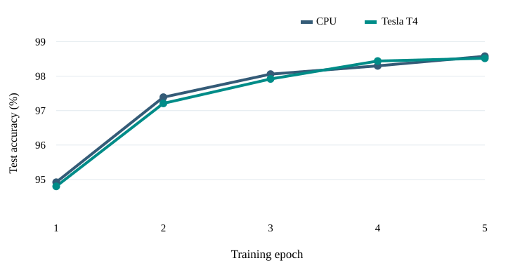
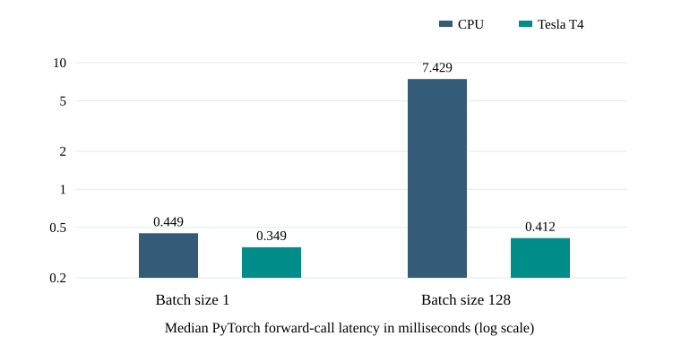

**Author affiliation:** Independent researcher, United States; M.S. Computer Engineering, Illinois Institute of Technology.  
**Correspondence:** fshroff95@gmail.com  
**Code and data:** https://github.com/fardeenshroff/lenet5-gpu-autotvm-optimization  
**Manuscript status:** Research preprint; not peer reviewed. Version 1.0, November 2026.

# 1. Introduction

GPU acceleration is frequently evaluated using a single timing ratio, yet a ratio without workload shape, synchronization policy, numerical validation, and an auditable execution environment is difficult to interpret. A GPU may offer substantial computational throughput at larger batch sizes while its advantage narrows when the workload contains only one small input and fixed launch or dispatch overhead becomes important. Reproducible comparisons therefore require more than identifying the accelerator: they require a specified model, dataset, timing boundary, input shape, framework version, and a clear separation between observed performance and architectural explanation.

This study examines that problem using LeNet-5, a compact convolutional network associated with the work of LeCun and colleagues [1], and the MNIST handwritten-digit benchmark. Rather than asserting that GPU execution is universally faster, we quantify training and inference under the same five-epoch PyTorch workflow and examine how the observed CPU-to-GPU ratio changes between batch sizes one and 128. The Tesla T4, based on NVIDIA's Turing architecture, provides the accelerator in the cloud experiment [2].

The contribution is an **auditable empirical comparison**, not a new neural network architecture or kernel scheduling algorithm. Specifically, the study (i) captures independent five-epoch CPU and GPU accuracy trajectories; (ii) measures end-to-end training-and-test wall time and synchronized eager inference; (iii) validates actual CUDA execution and a separately written C++ kernel; and (iv) publishes raw JSON results and executable code. A previous research report considered TVM and AutoTVM, which are compiler systems for graph and tensor-program optimization [3, 4]. Those historical results provide motivation, but no fresh TVM or AutoTVM benchmark is included in the present experimental evidence.

# 2. Related Work and Positioning

LeNet-style convolutional architectures provide a compact setting in which layers, tensor shapes, memory transfers, and computational schedules can be studied without the engineering complexity of a large-scale model [1]. PyTorch supports an imperative execution model with accelerator backends, making it suitable for using a nearly identical model implementation on CPU and GPU [5]. NVIDIA's T4 provides CUDA execution and hardware features intended for a variety of inference and training workloads [2].

Compiler-based methods such as TVM integrate graph-level transformations with target-specific operator compilation; AutoTVM-related research studies the search for favorable tensor schedules through cost modeling and autotuning [3, 4]. The present results **must not be interpreted as an AutoTVM-versus-PyTorch comparison**. Both five-epoch training measurements come from PyTorch, and both model-inference measurements come from PyTorch eager execution. The independent CUDA/C++ convolution demonstration measures a small correctness-oriented kernel, not a compiler-generated convolution schedule for the full network.

# 3. Experimental Design

## 3.1 Dataset, network, and optimization

MNIST provides 60,000 training images and 10,000 test images of 28×28 grayscale handwritten digits in ten classes [1, 6]. The implementation loads the dataset using `torchvision.datasets.MNIST`; tensors are normalized with mean 0.1307 and standard deviation 0.3081. No data augmentation is introduced by the supplied training script.

The implemented LeNet-5 variant contains a 5×5 convolution from one to six channels (padding two), hyperbolic-tangent activation, 2×2 average pooling, a second 5×5 convolution from six to sixteen channels, a further activation and 2×2 pooling stage, and three fully connected layers of sizes 400→120→84→10. Dropout with probabilities 0.25 and 0.50 is applied within the classifier during training and disabled during evaluation. This is an implementation *inspired by* LeNet-5, not a claim of byte-for-byte equivalence with the original 1998 architecture.

Both devices use cross-entropy loss, the Adam optimizer with learning rate 0.001, batch size 256, five epochs, and random seed 42. Each device trains its **own** model from initialization; the models are not the same trained checkpoint. Testing is performed on the official 10,000-image test set at the end of every epoch. Consequently, the reported test accuracy is a monitored evaluation trajectory rather than an untouched final holdout estimate. This distinction matters when interpreting small differences between CPU and GPU accuracies.

## 3.2 Execution environment and verification

The run was completed on Google Colab on 22 November 2026 using an NVIDIA Tesla T4, GPU compute capability 7.5, reported `nvidia-smi` memory 15,360 MiB, and driver version 580.82.07. Recorded software included Python 3.13.16, PyTorch 2.14.1+cu130, and a PyTorch CUDA runtime reported as 13.0. The notebook ran Linux 6.6.159+. The CPU model and its thread and memory characteristics were not included in the supplied five-epoch Colab JSON; therefore, the CPU in this experiment is described as the **Colab host CPU**, without a fabricated processor model. The GPU-check script established `torch.cuda.is_available() = True`, performed a 256×256 float32 CUDA matrix multiplication, and compared its output against a CPU reference.

**Table 1. Experiment configuration and evidence boundaries**

| Component | Verified configuration |
|:--|:--|
| Data | MNIST; 60,000 train / 10,000 test; 28×28 grayscale |
| Model | LeNet-5-inspired CNN; two convolutional and three dense layers |
| Optimizer | Adam, learning rate 0.001; cross-entropy objective |
| Training | 5 epochs; batch size 256; seed 42; separately trained CPU and GPU |
| Accelerator | NVIDIA Tesla T4, compute capability 7.5, CUDA runtime 13.0 |
| Software | PyTorch 2.14.1+cu130; Python 3.13.16 |
| Inference | Batch sizes 1 and 128; 30 warmups; 100 timed iterations |
| Raw evidence | Nine JSON files exported by the Colab notebook; source commit recorded |

## 3.3 Timing definitions and correctness checks

The training timer measures the five-epoch loop, including its periodic test-set evaluations. It does **not** measure a full real-world pipeline from dataset acquisition to service deployment, nor does it isolate forward pass, backward pass, data loading, or PCIe transfer cost. CUDA synchronization is performed around relevant phases before recording the training measurements. Define the observed training ratio as

$$S_{\mathrm{train}} = T_{\mathrm{CPU,train}}/T_{\mathrm{GPU,train}}.$$

For inference, the same trained **GPU checkpoint** is loaded on the CPU and the Tesla T4, so the observed latency comparison does not confound model weights. Each inference trial uses a synthetic float32 tensor of shape $B\times1\times28\times28$; the benchmark performs 30 warmup iterations followed by 100 timed iterations in inference mode. GPU execution is synchronized before and after each timed forward pass using `torch.cuda.synchronize()`, avoiding the misleading undercount associated with asynchronous kernel dispatch [7, 8]. Timed latency therefore includes host-side PyTorch invocation and GPU synchronization, but excludes dataset preprocessing, model initialization, checkpoint loading, and host-to-device input transfer. Speedup is based on **median batch latency**:

$$S_{\mathrm{infer}}(B) = \widetilde{t}_{\mathrm{CPU}}(B) / \widetilde{t}_{\mathrm{GPU}}(B).$$

The independent `conv2d_naive.cu` program compiles and executes a simple padded 5×5 convolution and compares GPU output against its CPU implementation. CUDA events time its kernel execution. This demonstration is a **separate microbenchmark**: its timing cannot be substituted for a full LeNet-5 inference time, nor can it establish compiler optimization effectiveness.

# 4. Results

## 4.1 Accuracy convergence and five-epoch training time

The separately trained GPU and CPU models converged to similar MNIST accuracy. As Table 2 and Figure 1 show, GPU test accuracy rose from 94.80% after epoch one to 98.52% at epoch five. The CPU path rose from 94.92% to 98.58%. The final 0.06-percentage-point difference corresponds to six predictions on a 10,000-example test set; **no inference of statistical superiority** is warranted from this single training run on each device.

**Table 2. Five-epoch accuracy and per-epoch timing**

| Epoch | CPU accuracy | T4 accuracy | CPU epoch (s) | T4 epoch (s) |
|---:|---:|---:|---:|---:|
| 1 | 94.92% | 94.80% | 27.868 | 19.944 |
| 2 | 97.39% | 97.21% | 23.821 | 15.129 |
| 3 | 98.06% | 97.92% | 23.132 | 15.987 |
| 4 | 98.30% | 98.44% | 23.707 | 14.807 |
| 5 | 98.58% | 98.52% | 23.746 | 17.035 |

{width=88%}

The total measured CPU training-and-evaluation wall time was **122.274 s**, compared with **82.904 s** for the T4, yielding **1.475× speedup**, equivalent to a 32.20% reduction in observed elapsed time. This is a whole-loop result rather than a pure convolution throughput measurement. Neither number is a claim of best-achievable performance; alternative batching, data-pipeline settings, kernel fusions, mixed precision, or compiler passes were not systematically explored.

## 4.2 Batch-size-dependent inference

Table 3 isolates the difference between lightly and more heavily batched inference using the **same model weights**. At batch size one, median CPU latency was 0.4494 ms versus 0.3486 ms on the GPU, an observed 1.29× advantage. At batch size 128, CPU median latency was 7.4287 ms while the GPU required 0.4119 ms, producing **18.03×** lower median batch latency. Since both devices process the same number of examples in each comparison, this also corresponds to an 18.03× ratio of implied model-forward throughput at batch 128; those figures are not application-level throughput measurements.

**Table 3. Warmed-up PyTorch eager inference (100 timed iterations)**

| Batch | CPU median (ms) | T4 median (ms) | Speedup | T4 mean (ms) |
|---:|---:|---:|---:|---:|
| 1 | 0.4494 | 0.3486 | **1.29×** | 0.3541 |
| 128 | 7.4287 | 0.4119 | **18.03×** | 0.4311 |

{width=88%}

The widening gap is consistent with increased utilization of the GPU's parallel execution resources as more examples are processed per invocation. The results do not directly measure occupancy, cache behavior, kernel-launch fraction, arithmetic intensity, Tensor Core utilization, or power consumption, so those factors remain **candidate explanations**, not experimentally established causes. In particular, nothing in the logged PyTorch execution demonstrates that Tensor Cores were engaged.

## 4.3 CUDA execution and kernel-level numerical validation

The separate CUDA runtime probe completed a 256×256 float32 matrix multiplication with output consistent with a CPU reference; its maximum absolute difference was **$4.20\times10^{-5}$**, which satisfied the probe's configured tolerance. It reported a CUDA-event median of **0.0597 ms** for that matrix multiplication. The custom 5×5 C++ convolution passed its independent reference check with maximum absolute error **$9.54\times10^{-7}$** and reported an average kernel time of **0.00616 ms** (6.16 µs). These measurements establish successful CUDA execution and elementary kernel correctness. They **do not** constitute accuracy metrics for MNIST classification and must not be combined with Table 3 to infer an end-to-end model speedup.

# 5. Discussion

Three findings are practically important. First, the five-epoch training comparison indicates a **measurable but moderate** advantage for the T4 in a small convolutional network. Second, model-level inference acceleration is highly workload dependent: a batch of one offers comparatively limited benefit, whereas the batch-128 result is markedly favorable to the GPU. Third, the near-identical CPU and GPU accuracies suggest that choosing a device chiefly changes the execution profile under these conditions; the present evidence does not indicate a meaningful accuracy advantage for either device.

The training-versus-inference contrast matters to engineering decisions. A CPU may be adequate for latency-sensitive, single-example traffic when GPU overhead and resource cost dominate; more heavily batched work may exploit accelerator parallelism efficiently. However, production decisions require workload traces, tail-latency distributions, resource costs, and measurement of transfer and preprocessing overhead, none of which were captured here. This study is therefore best interpreted as a **controlled educational benchmark**, not a production capacity-planning model.

The historical research manuscript reported a 2.39× acceleration using TVM/AutoTVM and different hardware, software, and training settings. Because the present repository's current GPU results are PyTorch-only, the historical figure **cannot be verified, refuted, or compared directly** with the observed 1.475× five-epoch training ratio. Benchmark scope, compiler stack, target GPU, and environment differ. Treating either number as proof of AutoTVM speedup would cross an essential evidentiary boundary.

# 6. Threats to Validity and Reproducibility

**Single execution and uncertainty.** Each CPU and GPU training configuration was executed once; the 100 inference iterations are repeated measurements within a single session, not independent training replications. The JSONs contain min/median/mean/max latency summaries rather than the underlying 100 samples, so confidence intervals, robust dispersion statistics, and a hypothesis test cannot be reconstructed. The 0.06-point final accuracy difference is descriptive only.

**Non-deterministic execution.** Seed 42 was configured, but complete cross-device determinism was not enforced or demonstrated. GPU kernels and framework releases may produce small numerical or execution differences despite a nominally shared seed [9]. The models' initial random-number streams can differ by execution device.

**Shared cloud resources.** Google Colab imposes variable CPU allocation, background load, CPU thread behavior, and GPU availability. The CPU processor model and complete thread controls were not included in the supplied Colab logs. A fair CPU-versus-GPU experiment was executed in the same Colab session, but hardware contention and scheduling could still affect timing.

**Timing boundary.** Training wall time includes repeated evaluation, while inference times isolate forward calls on already resident model and input tensors. The synthetic inference input avoids data-loading effects but limits end-to-end production generalizability. The study did not instrument kernel-level occupancy or measure energy use.

**Model and evaluation protocol.** The network is a specific LeNet-5-inspired variant, with dropout and specified preprocessing; it should not be generalized to arbitrary CNNs or LLMs. Test accuracy was inspected after each epoch rather than on a separate never-inspected holdout. Dataset/version and local modifications should be checked when independently reproducing.

# 7. Conclusion and Future Work

A verified NVIDIA Tesla T4 Colab experiment achieved **98.52% MNIST test accuracy** after five epochs and reduced the PyTorch training-and-evaluation loop from **122.27 to 82.90 seconds** (**1.47× speedup**) relative to its cloud CPU counterpart. Using identical trained GPU weights on both inference backends, the observed median inference ratio increased from **1.29× at batch size one to 18.03× at batch size 128**. Separate CUDA and CUDA/C++ reference checks supported genuine device execution and kernel-level numerical consistency. The central conclusion is that **batch shape and measurement scope materially influence reported GPU acceleration** even for a compact CNN.

Next steps should include repeated full training trials with independent seeds; complete device and CPU-thread provenance; raw per-iteration latency distributions and confidence intervals; data-transfer-inclusive benchmarks; profiling through NVIDIA Nsight; and a **new, explicitly instrumented TVM/AutoTVM experiment** on the same checkpoint and hardware. Such studies would enable stronger attribution of performance gains to compiler schedules rather than hardware selection alone.

# Data Availability, Funding, and Disclosure

**Artifacts.** Source code, scripts, Colab notebook, and benchmark documentation are available at https://github.com/fardeenshroff/lenet5-gpu-autotvm-optimization. The companion `results/` files retain the observed numerical outputs and provenance metadata. The five-epoch evidence originates from a user-supplied Colab ZIP with nine JSON reports; reported values were cross-checked against that archive. The user-supplied ZIP does not itself contain every individual inference timing sample or model checkpoint.

**Funding and competing interests.** No grant or sponsor was identified in the available research materials. Any formal submission should confirm funding, competing-interest, and authorship declarations with the author before publication. This preprint has not been peer reviewed.

# References

[1] Y. LeCun, L. Bottou, Y. Bengio, and P. Haffner, “Gradient-based learning applied to document recognition,” *Proceedings of the IEEE*, vol. 86, no. 11, pp. 2278–2324, 1998. DOI: https://doi.org/10.1109/5.726791.

[2] NVIDIA, “NVIDIA T4 Tensor Core GPU,” product documentation. https://www.nvidia.com/en-us/data-center/tesla-t4/ (accessed Nov. 2026).

[3] T. Chen *et al.*, “TVM: An automated end-to-end optimizing compiler for deep learning,” *13th USENIX Symposium on Operating Systems Design and Implementation (OSDI)*, pp. 578–594, 2018. https://www.usenix.org/conference/osdi18/presentation/chen.

[4] T. Chen, L. Zheng, E. Yan, Z. Jiang, T. Moreau, L. Ceze, C. Guestrin, and A. Krishnamurthy, “Learning to optimize tensor programs,” *Advances in Neural Information Processing Systems*, vol. 31, 2018. https://papers.neurips.cc/paper_files/paper/2018/hash/8b5700012be65c9da25f49408d959ca0-Abstract.html.

[5] A. Paszke *et al.*, “PyTorch: An imperative style, high-performance deep learning library,” *Advances in Neural Information Processing Systems*, vol. 32, pp. 8024–8035, 2019. https://proceedings.neurips.cc/paper_files/paper/2019/hash/bdbca288fee7f92f2bfa9f7012727740-Abstract.html.

[6] C. Cortes, Y. LeCun, and C. J. C. Burges, “The MNIST database of handwritten digits,” dataset description. https://github.com/cvdfoundation/mnist (accessed Nov. 2026).

[7] PyTorch, “CUDA semantics,” official documentation. https://docs.pytorch.org/docs/main/notes/cuda.html (accessed Nov. 2026).

[8] NVIDIA, “CUDA C++ Best Practices Guide,” official documentation. https://docs.nvidia.com/cuda/cuda-c-best-practices-guide/ (accessed Nov. 2026).

[9] PyTorch, “Reproducibility,” official documentation. https://docs.pytorch.org/docs/stable/notes/randomness.html (accessed Nov. 2026).